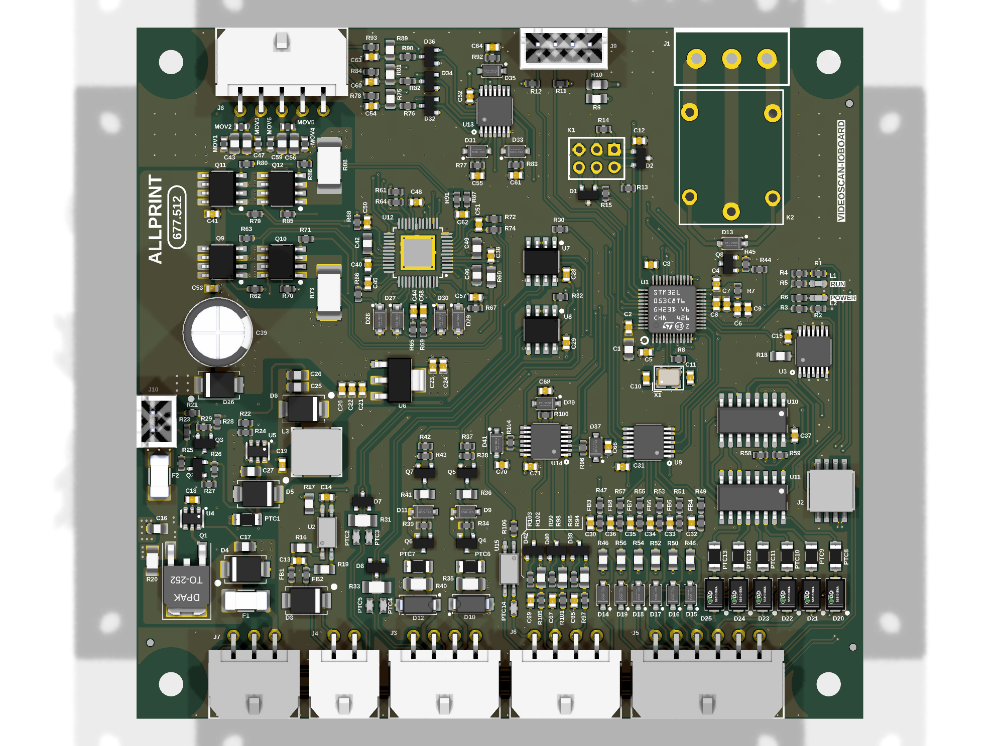
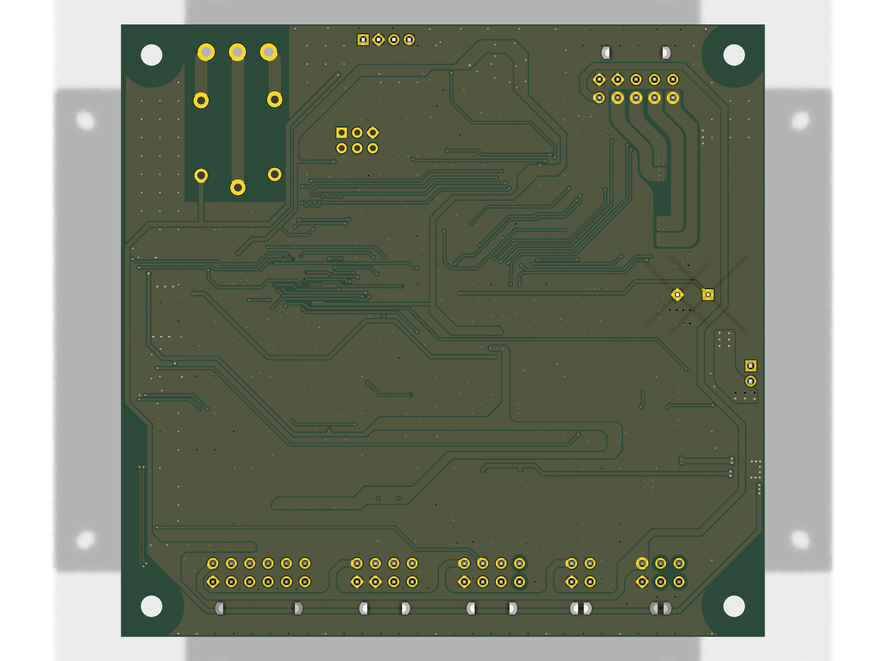

# Allprint — CapBoard (placa de captura)

Placa de captura do **AllPrint VideoScan**. Sincroniza a **câmera** e o **strobo de
LED** com o avanço do material (contando os dentes de uma engrenagem pelo encoder),
aciona o **motor de passo** por um **TMC5160** e concentra as entradas e saídas da
máquina. O processador é um **STM32G431CBT6**; o host conversa com ela por
**RS-485**, e ela repassa os comandos de lente para a
[head board](https://github.com/DextroAllprint/allprint-head-board) por um segundo
RS-485.

- **Projeto:** ALLPRINT-CAPBOARD-677512
- **Número Dextro:** 677.512
- **Placa:** 105,05 × 100,05 mm, **4 camadas**, montagem SMT só no lado top
- **Fabricante do projeto:** Dextro Labs Ltda — São Paulo/SP

> **Atenção — dois pares de 0 Ω em curto.** O projeto não tem variante de montagem,
> e o pick and place exportado pelo Altium (`Outputs/Pick Place/`) traz **os quatro**
> resistores abaixo. Montados aos pares, eles curto-circuitam alimentações:
>
> | Par | Escolhe | Montados juntos | O pacote monta |
> | --- | --- | --- | --- |
> | **R9 / R10** | Alimentação do pino 1 de J9: 3,3 V (R9) ou `VSYS` (R10) | 3,3 V em curto com `VSYS` | R9 |
> | **R61 / R64** | Nível do pino 21 (SD_MODE) do TMC5160: 3,3 V (R61) ou GND (R64) | 3,3 V em curto com GND | R64 |
>
> A escolha do R64 repete a da `cpu-video-scan`, cuja variante *Assembly* monta o
> mesmo circuito (R81) em GND. As exclusões estão em `montagem.nao_montar` de
> [`tools/fab/parametros.json`](tools/fab/parametros.json), e o build **falha** se
> encontrar dois 0 Ω montados em curto. Se algum lote foi montado pelos arquivos
> antigos do Altium, conferir R10 e R61 antes de energizar.

## Fotos da placa

<!-- fab:imagens -->
Vista de cima — o TMC5160 (U12) com as meias-pontes AO4882 e o conector do motor J8 à esquerda, o STM32G431 (U1) à direita, o relé K2 e o borne J1 no canto superior direito, e os conectores de campo J7, J4, J3, J6 e J5 na borda de baixo:

Vista de baixo — sem componentes: só trilhas, planos e os pinos dos conectores passantes:

> Renderizadas pelo CI a partir do `.PcbDoc`, a cada alteração do layout.
<!-- /fab:imagens -->

## Esquema elétrico

- **[Ver o esquema completo (PDF)](Outputs/Project_Outputs.PDF)** — abre no visualizador do GitHub
- Modelo 3D: [`Outputs/ExportSTEP/ALLPRINT-CAPBOARD-677512.step`](Outputs/ExportSTEP/ALLPRINT-CAPBOARD-677512.step)
- Projeto Altium: [`ALLPRINT-CAPBOARD-677512.PrjPcb`](ALLPRINT-CAPBOARD-677512.PrjPcb) · Layout: [`ALLPRINT-CAPBOARD-677512.PcbDoc`](ALLPRINT-CAPBOARD-677512.PcbDoc)

| Folha | O que tem |
| --- | --- |
| `GENERAL` | Folha de topo: todos os conectores de campo (J1, J3–J8) e a chave DIP J2 |
| `POWER` | Entrada com fusível de 10 A (F1), TVS SMBJ26CA, **diodo ideal LM74700** + MOSFET contra inversão de polaridade (`VSYS`), buck **AOZ1282** para 5 V com retenção `POWER_LOCK` e contato de liga J10, LDO **LM1117** para 3,3 V |
| `MCU` | **U1 — STM32G431CBT6**, cristal de 8 MHz, conector SWD (K1), expansão I²C (J9), LEDs e a leitura da chave de endereço |
| `HEAD-BOARD-COMM` | Dois **MAX485**: `COM` (host) e `AUX` (head board), com proteção SM712 e PTCs nas linhas |
| `STEP-MOTOR-DRIVER` | **TMC5160** com quatro meias-pontes **AO4882**, resistores de sensoriamento, fusível de 5 A (F2) na alimentação do motor, e a entrada do encoder do motor |
| `ENCODER-INPUT` | Entradas `EN0..EN2` do encoder da engrenagem, condicionadas por SN74HC04 |
| `INDEX-INPUTS` | Entrada de índice isolada por optoacoplador EL3H7 (`INDEX` / `INDEX'`) |
| `SIGNAL-INPUTS` | 6 entradas digitais `X00..X05` → `DI0..DI5` |
| `DIGITAL-OUTPUTS` | 6 saídas `Y00..Y05` por **PCF8574** (I²C2) + **ULN2003** (coletor aberto) |
| `SIGNAL-OUTPUTS` | Saídas `OUT_SYNC` (trigger da câmera) e `OUT_LED` (strobo) em high-side por P-MOSFET SI2319, e o relé **K2** (12 V, 15 A, SPDT) |
| `ISO-PGM` | Saída isolada por optoacoplador (`ISO_PGM_C` / `ISO_PGM_E`) |

## O microcontrolador

O cobre bate pino a pino com o mapa do firmware
([`docs/hw-migration-pinout.md`](https://github.com/DextroAllprint/allprint-firmware/blob/devel/docs/hw-migration-pinout.md)
no `allprint-firmware`):

| Função | Pinos do STM32G431 | Periférico |
| --- | --- | --- |
| RS-485 do host (`COM`, U7) | PA2 TX, PA3 RX, PA1 DE | USART2, DE por hardware |
| RS-485 da head board (`AUX`, U8) | PB10 TX, PB11 RX, PB9 DE | USART3, DE por software |
| TMC5160 (U12) | PB12 CS, PB13 SCK, PB14 MISO, PB15 MOSI | SPI2 |
| Encoder da engrenagem (`EN0..2`) | PB5 A, **PB6 B** (pulsos, TIM8), PB8 Z | TIM8 |
| Trigger da câmera (`OUT_SYNC`) | PA12 | TIM4_CH2 |
| Strobo (`OUT_LED`) | PB4 | TIM3_CH1 |
| Índice (`INDEX`) | PB0 | EXTI0 |
| Entradas `X00..X05` | PA4, PA5, PA6, PA7, PA10, PA11 | GPIO |
| Saídas `Y00..Y05` (PCF8574) | PA8 SDA, PA9 SCL | I2C2 |
| Expansão I²C (J9) | PB7 SDA, PA15 SCL | I2C1 |
| Relé K2 | PC13 | GPIO |
| Saída isolada (`ISO_PGM`) | PC14 | GPIO |
| Retenção da fonte (`POWER_LOCK`) | PA0 | GPIO |
| LEDs L2 / L1 + chave de endereço | PB1 / PB2 | GPIO |
| SWD (K1) | PA13 SWDIO, PA14 SWCLK, PB3 SWO, NRST | — |

O trigger e o strobo são gerados **100% em hardware**: o TIM8 conta os dentes da
engrenagem e dispara o TIM4 (SYNC) e o TIM3 (strobo) pelo mesmo `TRGO`, sem jitter
entre os dois.

## Conectores

Os conectores de campo J3–J8 trazem todos um pino da **alimentação de entrada**
(`V_IN` abaixo), a mesma net, **antes** do fusível F1. A alimentação nominal é
**12 V**: a bobina do relé K2 (12 V) vai direto em `VSYS`. A TVS de entrada
(SMBJ26CA) dá margem até 26 V.

### J3 — cabeça da câmera (MCFPL-08, passo 3 mm)

| Pino | Sinal | | Pino | Sinal |
| --- | --- | --- | --- | --- |
| 1 | `GND` | | 5 | `V_IN` |
| 2 | `OUT_SYNC` — trigger da câmera | | 6 | `Y00` |
| 3 | `OUT_LED` — strobo | | 7 | `X00` |
| 4 | `H_RS485_N` — RS-485 da head board | | 8 | `H_RS485_P` — RS-485 da head board |

### J4 — índice (MCFPL-04)

| Pino | Sinal |
| --- | --- |
| 1 | `GND` |
| 2 | `INDEX` — entrada do optoacoplador U2 |
| 3 | `V_IN` |
| 4 | `INDEX'` — retorno do optoacoplador U2 |

### J5 — entradas e saídas (MCFPL-12)

| Pino | Sinal | | Pino | Sinal |
| --- | --- | --- | --- | --- |
| 1 | `GND` | | 7 | `V_IN` |
| 2 | `X01` | | 8 | `Y01` |
| 3 | `X02` | | 9 | `Y02` |
| 4 | `X03` | | 10 | `Y03` |
| 5 | `X04` | | 11 | `Y04` |
| 6 | `X05` | | 12 | `Y05` |

As saídas `Y00..Y05` são de **coletor aberto** (ULN2003), com PTC e diodo de
roda-livre para `VSYS` em cada uma.

### J6 — encoder da engrenagem e saída isolada (MCFPL-08)

| Pino | Sinal | | Pino | Sinal |
| --- | --- | --- | --- | --- |
| 1 | `GND` | | 5 | `V_IN` |
| 2 | `GND` | | 6 | `EN0` |
| 3 | `EN2` | | 7 | `EN1` |
| 4 | `ISO_PGM_E` — emissor da saída isolada | | 8 | `ISO_PGM_C` — coletor da saída isolada |

### J7 — RS-485 do host (MCFPL-06)

| Pino | Sinal | | Pino | Sinal |
| --- | --- | --- | --- | --- |
| 1 | `GND` | | 4 | `V_IN` |
| 2 | `RS485_N` — barramento do host (U7) | | 5 | `RS485_P` — barramento do host (U7) |
| 3 | `O_RS485_P` — passagem | | 6 | `O_RS485_N` — passagem |

`O_RS485_P/N` não passa por transceptor: é um par que a chave DIP J2 pode ligar
direto ao RS-485 da head board (veja abaixo).

### J8 — motor de passo e encoder do motor (MCFPL-10)

| Pino | Sinal | | Pino | Sinal |
| --- | --- | --- | --- | --- |
| 1 | `SM_ENC_Z` | | 6 | `BMA1` — bobina A |
| 2 | `SM_ENC_B` | | 7 | `BMA2` — bobina A |
| 3 | `SM_ENC_A` | | 8 | `BMB2` — bobina B |
| 4 | `GND` | | 9 | `BMB1` — bobina B |
| 5 | `GND` | | 10 | `V_IN` |

### J1 — relé K2 (borne 5,08 mm, 3 vias)

| Pino | Sinal |
| --- | --- |
| 1 | `NF0` — normalmente fechado |
| 2 | `CM0` — comum |
| 3 | `NA0` — normalmente aberto |

### J9 — expansão I²C (PEMC1-04)

| Pino | Sinal |
| --- | --- |
| 1 | Alimentação do expansor: 3,3 V por **R9** ou `VSYS` por **R10** (montar só um) |
| 2 | `GND` |
| 3 | `EXP_SDA` (PB7) |
| 4 | `EXP_SCL` (PA15) |

### J10 — contato de liga (PEMC1-02)

Fecha o enable do buck AOZ1282. Depois de ligada, a placa se mantém ligada por
`POWER_LOCK` (PA0).

### J2 — chave DIP de 4 vias

| Chave | Liga | Efeito |
| --- | --- | --- |
| 1 | J2.1 ↔ J2.8 (GND) | Bit de endereço em **PB1** (pull-up de 10 kΩ, 1 kΩ em série) |
| 2 | J2.2 ↔ J2.7 (GND) | Bit de endereço em **PB2** (idem) |
| 3 | `O_RS485_P` ↔ `H_RS485_P` | Junta o par de passagem do J7 ao RS-485 da head board |
| 4 | `O_RS485_N` ↔ `H_RS485_N` | Idem, linha N |

PB1 e PB2 são as mesmas linhas dos LEDs L2 e L1: a chave puxa a linha para GND por
1 kΩ.

### LEDs

| LED | Serigrafia | Pino |
| --- | --- | --- |
| L1 | RUN | PB2 (via R5) |
| L2 | POWER | PB1 (via R6) |

> **Serigrafia × firmware.** O `allprint-firmware` chama PB1 de `STATUS_LED` e PB2 de
> `POWER_LED`, ao contrário da serigrafia (PB1 acende o LED marcado POWER, PB2 o
> marcado RUN). Um dos dois precisa ser corrigido.

### K1 — gravação SWD (barra 2 × 3)

| Pino | Sinal |
| --- | --- |
| 1 | `3,3V` |
| 2 | `SWDIO` (PA13) |
| 3 | `RST` (NRST) |
| 4 | `SWCLK` (PA14) |
| 5 | `GND` |
| 6 | `SWO` (PB3) |

O pino a pino completo — conectores, o STM32 e o TMC5160 — sai do cobre a cada build
em [`docs/PINOUT.md`](docs/PINOUT.md).

## Arquivos para fabricação

<!-- fab:dados -->
Os links abaixo apontam sempre para o **ultimo** pacote publicado — nao
mudam de endereco a cada versao, mesmo com os arquivos versionados por dentro.

> Como o repositorio e privado, esses links exigem sessao do GitHub no
> navegador. Para baixar por script ou de outro CI, use a API:
> `gh release download --repo <org>/<repo> --pattern '*-latest.*'`.

| Baixar | Arquivo |
| --- | --- |
| **[⬇ Pacote de fabricacao completo](https://github.com/DextroAllprint/allprint-capboard/releases/latest/download/ALLPRINT-CAPBOARD-677512-fab-latest.zip)** | Gerbers, furacao, BOM, pick and place, previa e esquema |
| [⬇ BOM de engenharia](https://github.com/DextroAllprint/allprint-capboard/releases/latest/download/ALLPRINT-CAPBOARD-677512-bom-latest.csv) | Todos os componentes, com coluna LCSC |
| [⬇ BOM da JLCPCB](https://github.com/DextroAllprint/allprint-capboard/releases/latest/download/ALLPRINT-CAPBOARD-677512-jlcpcb-bom-latest.csv) | Formato de montagem: Comment, Designator, Footprint, LCSC Part # |
| [⬇ Pick and place da JLCPCB](https://github.com/DextroAllprint/allprint-capboard/releases/latest/download/ALLPRINT-CAPBOARD-677512-jlcpcb-cpl-latest.csv) | Designator, Mid X, Mid Y, Layer, Rotation |
| [⬇ Esquema eletrico](https://github.com/DextroAllprint/allprint-capboard/releases/latest/download/ALLPRINT-CAPBOARD-677512-esquema-latest.pdf) | PDF do esquema |

Versao publicada: **`revA-20261120-local`**. Dentro do pacote os arquivos levam
essa mesma versao no nome. A previa camada a camada esta em
[`docs/PREVIA-GERBERS.md`](docs/PREVIA-GERBERS.md), e o pino a pino de
conectores e CIs em [`docs/PINOUT.md`](docs/PINOUT.md).

| Item | Valor |
| --- | --- |
| Dimensoes | 105.05 × 100.05 mm |
| Camadas de cobre | 4 |
| Componentes | 299 |
| Nets | 220 |
| Trilha minima | 0.184 mm |
| Furo minimo | 0.2 mm |
| Montagem | JLCPCB, SMT lado top |
| Componentes montados | 278 de 295 (70 referencia LCSC) |
| Fornecimento Dextro | 17 componentes sem codigo LCSC, soldados a mao |

Furacao:

| Diametro | Furos | Tipo |
| --- | --- | --- |
| 3.5 mm | 4 | NPTH |
| 0.2 mm | 591 | PTH |
| 0.3 mm | 173 | PTH |
| 0.8 mm | 2 | PTH |
| 1.0 mm | 6 | PTH |
| 1.1 mm | 54 | PTH |
| 1.3 mm | 5 | PTH |
| 1.6 mm | 3 | PTH |
| **Total** | **838** | 834 PTH + 4 NPTH |

> **Avisos do ultimo build:**
>
> - R10 fora da montagem por parametros.json: R9 e R10 (0R) escolhem a alimentacao do pino 1 de J9 — 3,3V por R9 ou VSYS por R10. Montar os dois poe 3,3V em curto com VSYS. Sai R9 (3,3V); trocar aqui se o expansor pedir VSYS.
> - R61 fora da montagem por parametros.json: R61 (3,3V) e R64 (GND) escolhem o nivel do pino 21 (SD_MODE) do TMC5160; montar os dois poe 3,3V em curto com GND. Fica R64 (GND), como na variante Assembly da cpu-video-scan (R78 fora, R81 montado).
<!-- /fab:dados -->

## Como o pacote é gerado

O pacote **não é exportado à mão**. O workflow
[`.github/workflows/fabricacao.yml`](.github/workflows/fabricacao.yml) roda a cada
alteração do `.PcbDoc` ou das folhas de esquema e monta tudo em runner Linux, sem
Altium:

1. Lê o `.PcbDoc` com o importador de PCB do Altium do KiCad 9, exposto na API
   Python (`pcbnew.PCB_IO_MGR.ALTIUM_DESIGNER`) — headless, sem GUI.
2. Plota as **4 camadas de cobre** e as demais, e a furação, pelo `kicad-cli`, com a
   origem ancorada no canto inferior esquerdo. Gerber, furação e pick and place saem
   no mesmo referencial.
3. Lê a **BOM das 11 folhas de esquema** ([`tools/fab/esquema.py`](tools/fab/esquema.py)),
   de onde vem o código **LCSC**, e agrupa os símbolos multiparte numa peça só.
4. Gera a BOM de engenharia, a BOM e o pick and place da JLCPCB, a prévia dos
   Gerbers camada a camada e o **pinout** ([`tools/fab/pinout.py`](tools/fab/pinout.py)).
5. **Valida** e falha o build se faltar camada, se algum arquivo sair com 0 byte, se
   a furação divergir do `.DRR` exportado pelo Altium, se a BOM e o CPL não
   casarem, ou se o encapsulamento comprado não bater com o land pattern do PCB.
6. Publica o Release e reescreve os blocos gerados deste README.

Os arquivos saem **versionados** (`revA-<data>-<commit>`), e o Release carrega também
cópias `-latest` de nome fixo — são elas que sustentam os links de download acima.

Onde mexer:

| Para mudar | Edite |
| --- | --- |
| Material, espessura, acabamento, quantidade | [`tools/fab/parametros.json`](tools/fab/parametros.json) |
| Tirar um componente específico da montagem (opção de 0 Ω, jumper) | `montagem.nao_montar` em [`tools/fab/parametros.json`](tools/fab/parametros.json) |
| Tirar uma peça da montagem, ou substituí-la | [`tools/fab/pecas.json`](tools/fab/pecas.json) |
| Código LCSC de um componente | O parâmetro `LCSC` no esquema, no Altium |
| Legenda das fotos, o que entra no pinout | `legendas` e `pinout` em [`tools/fab/parametros.json`](tools/fab/parametros.json) |

> **O esquema é a exceção.** O importador de `.SchDoc` do KiCad só existe na GUI. As
> folhas são lidas aqui só como dado (BOM e LCSC) — o **PDF** continua saindo do
> OutJob do Altium, à mão. Quando uma folha muda depois do PDF, o build avisa.

## Repositórios relacionados

- [`allprint-firmware`](https://github.com/DextroAllprint/allprint-firmware) — firmware do STM32G431 desta placa
- [`allprint-head-board`](https://github.com/DextroAllprint/allprint-head-board) — placa de zoom, foco e íris, no RS-485 `AUX`
- [`allprint-headboard-firmware`](https://github.com/DextroAllprint/allprint-headboard-firmware) — firmware da head board
- [`allprint-signal-board`](https://github.com/DextroAllprint/allprint-signal-board) — placa de sinais da Orange Pi 3B
- [`allprint-videoscan`](https://github.com/DextroAllprint/allprint-videoscan) — aplicação da estação

---

© Dextro Labs Ltda — São Paulo/SP, Brasil · [dextrolabs.com.br](https://www.dextrolabs.com.br)
